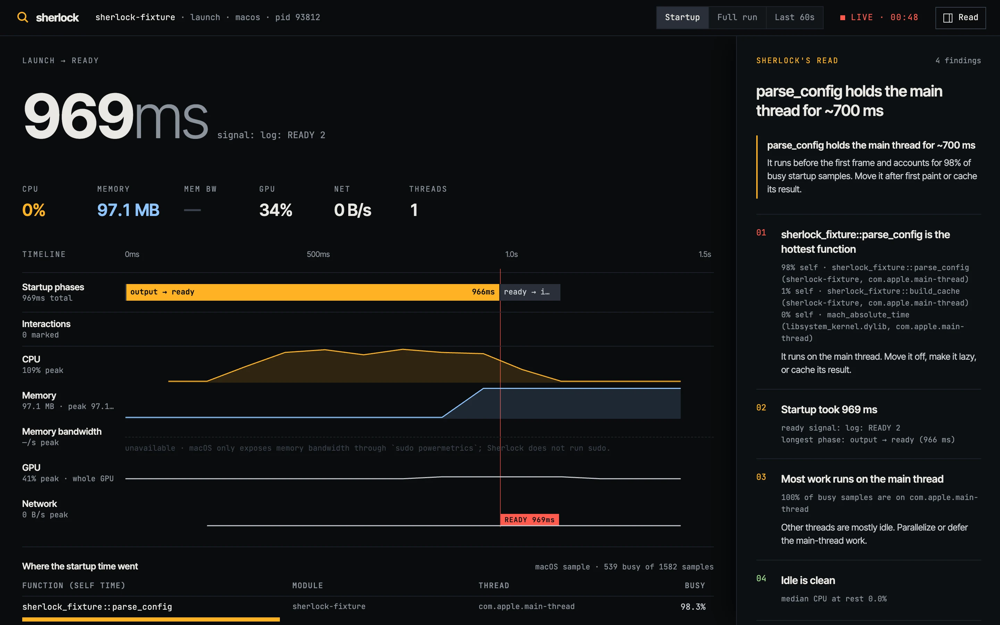
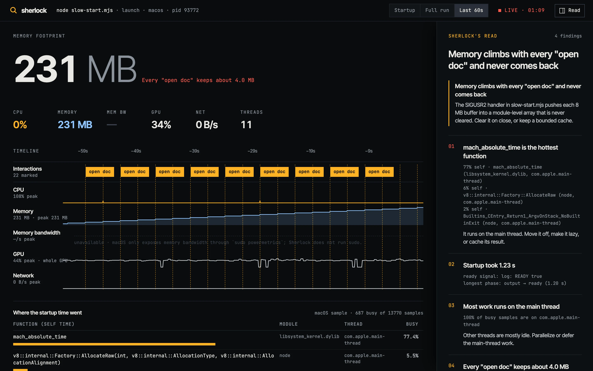
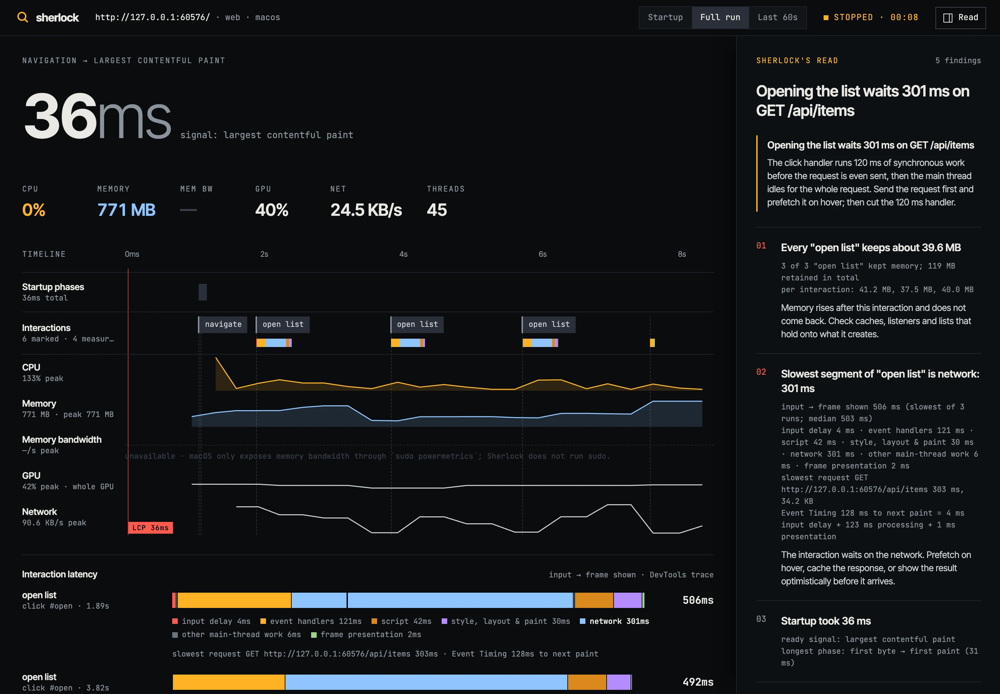

<h1 align="center">Sherlock</h1>

<p align="center"><b>An agentic profiler. It launches or attaches to your app, watches it run, and tells you where the time and the memory went.</b><br>Startup time, CPU, memory, memory bandwidth, GPU and network on one live timeline, for native, desktop, web and mobile apps.</p>

<p align="center">
  <a href="https://code.claude.com/docs/en/plugins"></a>
  <a href="https://modelcontextprotocol.io"></a>
  <a href="LICENSE"></a>
  <a href="#requirements"></a>
  <a href="#requirements"></a>
  <a href="https://github.com/hiftikha/sherlock/actions/workflows/ci.yml"></a>
</p>

<p align="center">
  <a href="https://skills.wheresryan.sh/sherlock"></a>
  &nbsp;
  <a href="#install"></a>
  &nbsp;
  <a href="#install"></a>
</p>

<p align="center">
  <a href="#quick-start">Quick start</a> ·
  <a href="#gallery">Gallery</a> ·
  <a href="#what-it-measures">What it measures</a> ·
  <a href="#install">Install</a> ·
  <a href="#usage">Usage</a> ·
  <a href="#how-it-works">How it works</a> ·
  <a href="#limits">Limits</a>
</p>

<p align="center">
  
</p>

<p align="center"><sub>A Rust binary's cold start. The call stacks were captured from the first instruction, symbols demangled, and the hot function tied to the phase it slowed down.</sub></p>

---

Every time an app is slow to start or heavy to run, someone builds a one-off harness for that one repo: launch it, poll some numbers, eyeball a chart, guess. Sherlock replaces the harness. An agent reads the project, works out what it is and how to run it, launches a release build with a ready signal, samples the whole process tree every 100 ms, captures where the startup time went, and keeps watching while you click through the app. Mark an interaction and repeat it, and Sherlock tells you how much memory each one keeps. On a web page it performs the interaction itself and breaks its latency down end to end, from the input to the frame that shows the result, and names the segment that lags most.

The measuring is a small, dependency-free Node engine built on the tools your OS already ships (`ps`, `footprint`, `sample`, `nettop`, `/proc`, `perf`, `simctl`, `adb`, the Chrome DevTools Protocol). The judgment is Claude: which scenario to run, which numbers matter, which line of your code caused them.

## Quick start

In [Claude Code](https://code.claude.com):

```text
/plugin marketplace add hiftikha/sherlock
/plugin install sherlock@sherlock
```

Then, in any project:

```text
/sherlock:profile why is the cold start of the release build slow?
```

Or without Claude Code installed first, from any project folder:

```sh
npx sherlock-profiler            # from npm
npx github:hiftikha/sherlock     # or straight from this repository
```

The wizard detects the project, then offers to open Claude Code with Sherlock loaded, run the agent in the terminal with your API key, profile it directly without an agent, or install the plugin for every project.

## Gallery

<table>
  <tr>
    <td width="50%"></td>
    <td width="50%"></td>
  </tr>
  <tr>
    <td><sub><b>Startup.</b> Phases from spawn to first output to ready to idle, the ready line drawn through every lane, and the functions that burned the startup time.</sub></td>
    <td><sub><b>Live.</b> The last 60 seconds, with interaction markers dropped through every lane. Memory steps up after each "open doc" and never returns, and Sherlock says so.</sub></td>
  </tr>
  <tr>
    <td colspan="2"></td>
  </tr>
  <tr>
    <td colspan="2"><sub><b>Interaction latency.</b> Each click traced from the input to the frame that shows the result, split into input delay, handlers, script, network, rendering and presentation. The network wait is the biggest piece, and the 120 ms handler runs before the request is even sent.</sub></td>
  </tr>
</table>

The dashboard is one local page that updates as the app runs. Numbers animate with [NumberFlow](https://number-flow.barvian.me), the right rail collapses (`]`), `m` marks an interaction, and every run is saved as a JSON report plus a standalone HTML page you can send to someone.

## What it measures

| | Native (macOS) | Native (Linux) | Web (Chrome) | iOS Simulator | Android |
|---|---|---|---|---|---|
| **Startup** | spawn → first output → ready → idle | same | TTFB, FCP, LCP, load, CLS | launch → main thread quiet | `am start -W` to first frame |
| **Where startup went** | call stacks from the first instruction (`sample`), demangled Rust and C++ | — | long tasks from a DevTools trace, script, layout and style time, slowest requests, `.wasm` loads | call stacks (`sample`) | — |
| **CPU** | process tree, 100 ms | process tree, `/proc` | browser process tree | app process | `/proc` over adb |
| **Memory** | physical footprint (dirty + compressed) | RSS | JS heap + browser tree | footprint | RSS and PSS |
| **Memory bandwidth** | not exposed without sudo | `perf` LLC misses × 64 B, estimate | — | — | — |
| **GPU** | whole-GPU utilization (`ioreg`) | — | — | — | — |
| **Network** | per process (`nettop`) | network namespace | request weight | — | app namespace |
| **Interactions** | marks, CPU busy time and memory per interaction, call stacks around a mark | marks, CPU busy time and memory per interaction | closed-loop latency: input delay → handlers → script → network → style, layout & paint → frame shown | marks + per-interaction CPU and memory | same |

A metric Sherlock can't measure on a target is shown as unavailable with the reason, never as a flat line or a guess.

### Interaction latency

`sherlock_interact` (or `sherlock interact` on the command line) clicks a selector or a point, or presses a key, on a page in headless Chrome, and records a DevTools trace around it. From the trace it splits the time between the input and the frame that shows the result into segments, each measured, none inferred:

| Segment | What fills it |
|---|---|
| input delay | the input's timestamp to its first handler starting (Event Timing) |
| event handlers | `EventDispatch` for the interaction's events |
| script | promise callbacks, timers and other script after the handlers |
| network | the main thread idle while a request the interaction sent is in flight |
| style, layout & paint | `UpdateLayoutTree`, `Layout`, `Paint`, `Commit` |
| idle | the main thread idle with nothing in flight (timers, debounce) |
| frame presentation | the last commit to `Display::FrameDisplayed` |

The breakdown is drawn as a segmented bar on the Interactions lane and in an Interaction latency panel, with the slowest request, the longest scripts, layout cost, the Event Timing (INP) numbers for the same input, and optionally the hottest JavaScript from the V8 sampler. The finding reads `Slowest segment of "open list" is network: 301 ms`. Pass `done_selector` (`--done`) to end the interaction when its result appears; otherwise it ends at the frame after the last script-driven update once the network goes quiet.

For native apps, every mark gets a CPU and memory summary (busy time after it, CPU average and peak, memory before, peak and after), and `sherlock_mark` with `stacks_seconds` (`--mark-stacks` in the CLI) samples call stacks during the interaction on macOS.

It works on anything that runs as a process: Rust, Go, Swift, C and C++ binaries, Tauri and Electron apps (the webview and helper processes are in the tree), Node, Python, dev servers, and Rust compiled to WebAssembly in the browser.

## Install

Pick one way in:

| | Command | What you get |
|---|---|---|
| **Claude Code plugin** | `/plugin marketplace add hiftikha/sherlock`<br>`/plugin install sherlock@sherlock` | The `/sherlock:profile` skill and the `sherlock` MCP tools in every session |
| **npx wizard** | `npx sherlock-profiler` | Detects the project and runs a drill pass, with or without an agent |
| **npx, straight from GitHub** | `npx github:hiftikha/sherlock` | The same, from the latest commit on `main` |
| **Global CLI** | `npm install -g sherlock-profiler` | `sherlock` on your PATH |
| **Plugin for one session** | `claude --plugin-dir ./sherlock` | Load a local clone without installing |

<details>
<summary><b>Install the plugin from the terminal</b></summary>

<br>

```sh
claude plugin marketplace add hiftikha/sherlock
claude plugin install sherlock@sherlock
```

or let the CLI do both: `npx sherlock-profiler install`.

</details>

## Usage

### In Claude Code

```text
/sherlock:profile
/sherlock:profile the dev server takes 8 seconds to come up
/sherlock:profile memory after opening five documents
/sherlock:profile compare cold start before and after my change
```

You don't have to name the skill. Claude also uses Sherlock when you ask why an app is slow to start, uses too much memory, or leaks after an interaction. A drill pass goes: detect the project, profile a release build with a ready signal, open the dashboard, read the startup phases and hot functions and find them in your code, drive two or three interactions three times each, write the findings into the dashboard, and save the report under `.sherlock/`.

### As an agent in your terminal

```sh
export ANTHROPIC_API_KEY=...
npx sherlock-profiler agent "why does the app take 2 seconds to show a window?"
```

The agent runs on `claude-opus-5-5` with the same playbook and tools as the plugin, plus `read_file`, `search_code` and `run_command`. It asks before running any command or launching anything. `--yes` skips the questions.

### Without an agent

```sh
sherlock launch --ready-log 'listening on' -- ./target/release/server
sherlock launch --ready-port 3000 -- npm run dev
sherlock attach my-app                       # by name or pid
sherlock web http://localhost:3000/ --throttle 4
sherlock interact http://localhost:3000/ --click '#open' --label 'open list' --done '#list li' --repeat 3
sherlock interact http://localhost:3000/ --click '#search' --key a --label 'type in search'
sherlock launch --mark-stacks 3 -- ./target/release/app   # stacks around each mark (macOS)
sherlock ios com.example.app                 # the booted Simulator
sherlock android com.example.app             # a device or emulator
sherlock detect                              # what is this project?
sherlock report .sherlock/sherlock-1a2b3c4d.json
```

While a launch or attach is live, type a label and press enter to mark an interaction, or press enter alone to stop and save the report. `--json` prints a machine-readable digest, `--exit` stops after startup, `--no-ui` skips the dashboard.

## How it works

- **[`src/platform/host.mjs`](src/platform/host.mjs)** samples a process tree. On macOS: `ps` for CPU time, `footprint` for memory, `ps -M` for threads, `nettop` for network, `ioreg` for the GPU. On Linux: `/proc/<pid>/{stat,status,io,net/dev}` and, when `perf` is allowed, LLC miss counters for memory bandwidth. CPU is computed from cumulative CPU time between samples, so it's exact for short spikes rather than a decayed average.
- **[`src/launch.mjs`](src/launch.mjs)** launches the app and times its phases: spawn, first output, a ready signal (a log line, a port, a URL) and the CPU going quiet. On macOS a separate warm-up launch captures call stacks from the first instruction with `sample -wait`, because attaching a sampler freezes the process for a few hundred milliseconds and would distort the timed run.
- **[`src/platform/web.mjs`](src/platform/web.mjs)** drives headless Chrome over the DevTools Protocol with no Puppeteer: navigation timing, paint and LCP observers, a timeline trace for long tasks, runtime metrics, and the browser's own process tree. For an interaction it dispatches the input with `Input.dispatchMouseEvent` or `Input.dispatchKeyEvent` inside a trace bracketed by user-timing marks, and [`src/parse/trace.mjs`](src/parse/trace.mjs) turns the trace into segments.
- **[`src/interaction.mjs`](src/interaction.mjs)** summarizes CPU and memory after every mark and samples call stacks around one.
- **[`src/platform/mobile.mjs`](src/platform/mobile.mjs)** cold-launches iOS apps with `simctl` and samples the Simulator process on the Mac, and Android apps with `am start -W` and `/proc` over `adb`.
- **[`src/findings.mjs`](src/findings.mjs)** turns samples into findings: wait-bound vs CPU-bound startup, the hot function, main-thread-bound work, memory each repeated interaction keeps, the slowest segment of each interaction, CPU busy time after a mark, steady growth, and idle CPU.
- **[`src/mcp.mjs`](src/mcp.mjs)** and **[`src/tools.mjs`](src/tools.mjs)** expose all of it as 14 MCP tools. The plugin's [`.mcp.json`](.mcp.json) runs it with `node`, no install step.
- **[`skills/profile/SKILL.md`](skills/profile/SKILL.md)** is the playbook Claude follows for a drill pass. The terminal agent ([`src/agent.mjs`](src/agent.mjs)) uses the same file as its system prompt.
- **[`ui/`](ui)** is the dashboard: plain HTML, CSS and JavaScript fed by server-sent events from a server bound to `127.0.0.1`.

<details>
<summary><b>Repository layout</b></summary>

<br>

```text
sherlock/
├── .claude-plugin/        plugin.json and marketplace.json
├── .mcp.json              the MCP server the plugin starts
├── skills/profile/        the drill-pass playbook (/sherlock:profile)
├── cli/sherlock.mjs       the CLI and npx wizard
├── src/
│   ├── platform/          host (macOS, Linux), web, mobile samplers
│   ├── parse/             pure parsers for every tool's output
│   ├── launch.mjs         launch, attach, startup phases, stacks
│   ├── findings.mjs       rules that turn samples into findings
│   ├── tools.mjs          the tool layer shared by MCP and the agent
│   ├── mcp.mjs            stdio MCP server
│   ├── agent.mjs          terminal agent on the Claude API
│   └── server.mjs         dashboard server and HTML reports
├── ui/                    the dashboard
├── test/                  unit tests per platform, integration tests, fixtures
└── docs/                  the website
```

</details>

## Privacy and what it runs

Sherlock runs only on your machine. It starts the commands you or the agent choose (the terminal agent asks first), reads process information with the system tools listed above, and serves the dashboard on `127.0.0.1`. The dashboard page loads its fonts from Google Fonts and NumberFlow from jsDelivr; without network it falls back to system fonts and plain numbers. The terminal agent sends your goal, tool results and the files it reads to the Claude API using your key. The plugin itself makes no network calls; Claude Code's own model calls are covered by your Claude Code settings. Reports are written to `.sherlock/` in the project.

## Limits

- **Memory bandwidth on macOS isn't measured.** Apple exposes it only through `sudo powermetrics`, and Sherlock never runs sudo. On Linux it's an estimate from last-level cache misses and needs `perf` with `perf_event_paranoid` ≤ 1.
- **macOS GPU is the whole GPU**, not your process. It's still useful for seeing a render spike line up with an interaction.
- **Startup on macOS is a warm start** when call stacks are on, because the warm-up launch runs first. Pass `--no-stacks` for a launch with nothing before it. Neither is a true cold start after a reboot.
- **iOS Simulator timings run on your Mac's CPU.** Use them to compare builds, not as device numbers.
- **Linux call stacks and Android memory bandwidth** aren't wired up yet.
- **End-to-end interaction latency is web only.** On a page Sherlock performs the input and traces it to the frame. In a native app it doesn't hook input events or frame presentation, so a marked interaction gets CPU busy time, memory and (on macOS) call stacks, not an input → frame breakdown. Busy time comes from 100–250 ms samples, so it's accurate to one sample.
- **Without `done_selector`, the end of a web interaction is inferred from quiet**: the network idle for 500 ms and the frame after the last script-driven update. A page that animates or polls continuously gets a note saying the end is approximate.

## Requirements

| | Needed for | Notes |
|---|---|---|
| **Node.js 22+** | everything | No runtime dependencies for profiling. `@anthropic-ai/sdk` is loaded only by the terminal agent. |
| **macOS or Linux** | native profiling | Windows isn't supported yet. |
| **[Claude Code](https://code.claude.com)** | the plugin and the wizard's Claude Code mode | |
| **An Anthropic API key** | `sherlock agent` only | |
| **Chrome or Chromium** | web profiling | Found in the usual places and Playwright's cache. Set `CHROME_PATH` for anything else. |
| **Xcode** | iOS Simulator | A booted Simulator. |
| **Android platform tools** | Android | `adb` on PATH, or `SHERLOCK_ADB`. |
| **`perf`** | Linux memory bandwidth | Optional. |

## Development

```sh
git clone https://github.com/hiftikha/sherlock.git && cd sherlock
npm install
npm test
```

The test suite has unit tests for every platform's parsers and integration tests that profile real processes: a Node app, a Rust app built with cargo, a page in headless Chrome (page load and clicked and typed interactions), the iOS Simulator and Android through recorded `simctl` and `adb` stand-ins (and real ones when a Simulator is booted or a device is connected), the MCP server, the dashboard and the CLI. CI runs it on macOS and Linux. See [CONTRIBUTING.md](CONTRIBUTING.md).

## License

[MIT](LICENSE) © 2026 Haroon Iftikhar

<p align="center"><sub>If Sherlock found something for you, a ⭐ helps other people find it.</sub></p>
